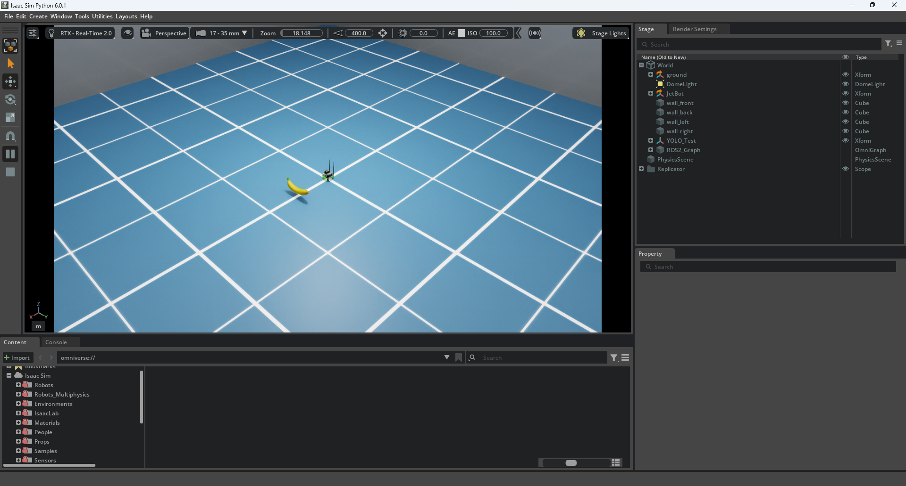
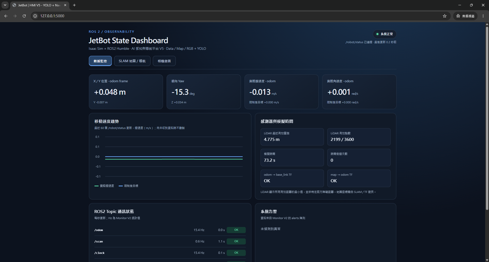
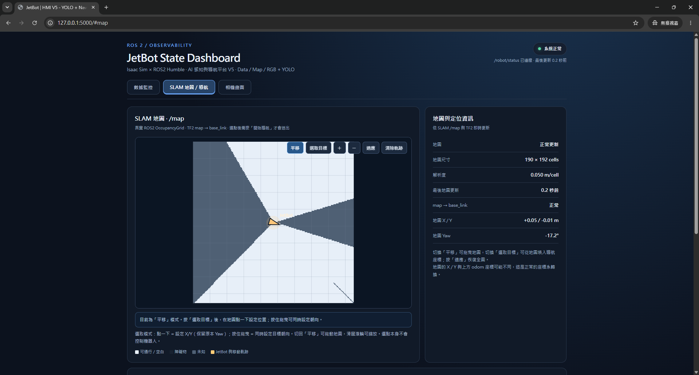
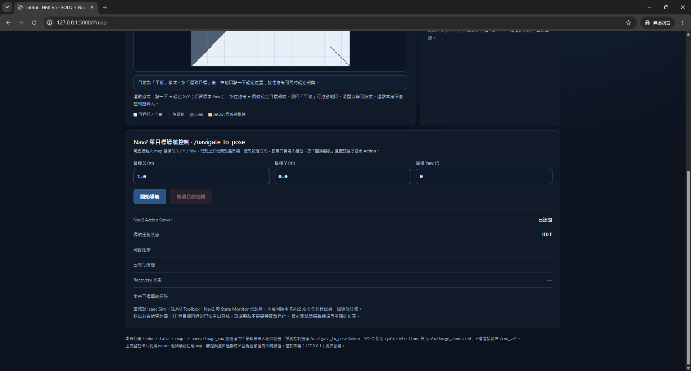
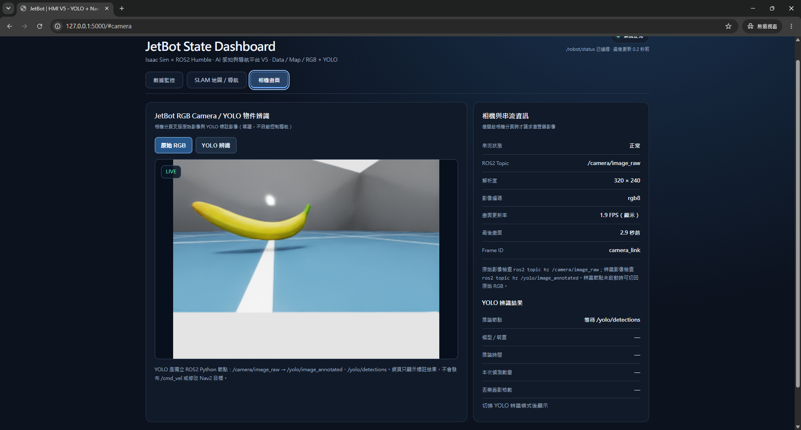
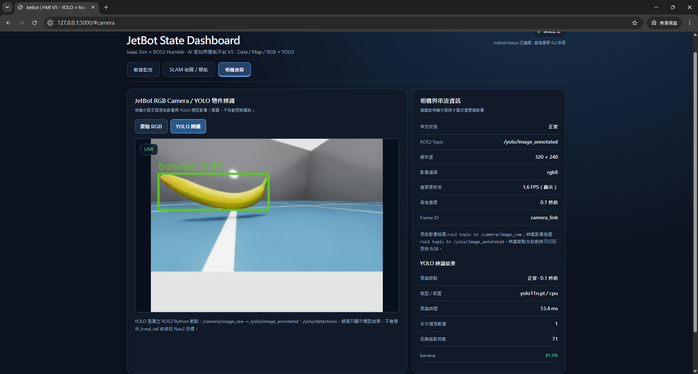

# JetBot ROS2 自主導航與 AI 視覺監控平台

**JetBot ROS2 AI Navigation & Monitoring Platform**

本專案以 NVIDIA Isaac Sim 建立移動機器人模擬環境，整合 ROS2 Humble、SLAM Toolbox、Nav2、YOLO11 與 Flask，開發具備自主導航、AI 物件辨識、即時狀態監控及網頁人機介面（HMI）的機器人控制平台。

專案採用模組化 Python 架構，分別處理機器人模擬、ROS2 通訊、導航、視覺感知與網頁控制，並以 Windows 11 + WSL2 Ubuntu 作為整合開發環境。

## 1. 專案功能

### 1.1 機器人模擬與控制

- 使用 NVIDIA Isaac Sim 建立 JetBot 差速輪移動機器人模擬環境。
- 透過 ROS2 `/cmd_vel` 訂閱控制機器人前進、後退及原地旋轉。
- 整合 RTX LiDAR 與 RGB Camera。
- 發布 `/odom`、`/tf`、`/scan`、`/clock` 等 ROS2 資料。
- 使用 Python Standalone Script 自動建立與執行模擬場景。

### 1.2 SLAM 建圖與自主導航

- 整合 SLAM Toolbox 建立 2D Occupancy Grid Map。
- 使用 TF2 管理 `map`、`odom`、`base_link` 和 `lidar_link` 座標系。
- 整合 Nav2 完成單一目標的路徑規劃及自主導航。
- 支援透過網頁輸入目標座標，或直接點選地圖設定導航位置。
- 透過 ROS2 `NavigateToPose` Action 接收導航進度、完成結果與取消請求。

目前以**單目標自主導航**為主要功能，暫不包含多目標循環巡邏。

### 1.3 Robot State Monitor 系統監控

使用 Python 與 ROS2 開發獨立的機器人狀態監控節點，具備以下功能：

- 機器人位置、朝向與實際速度監控。
- LiDAR 最近有效量測距離。
- ROS2 Topic 更新頻率與通訊狀態檢查。
- TF 時間戳記及座標轉換狀態監控。
- 速度命令與實際速度比較。
- 感測器通訊逾時及異常告警。
- 將整合結果以 JSON 格式發布至 `/robot/status`。

### 1.4 Flask 網頁人機介面（HMI）

以 Flask 開發三分頁式機器人監控與控制平台。

**數據監控**

- 位置、朝向與移動速度。
- 速度變化趨勢圖。
- LiDAR 距離與感測器狀態。
- ROS2 Topic 通訊頻率。
- 系統健康狀態與異常告警。

**SLAM 地圖與導航**

- 即時顯示 `/map` 地圖。
- 顯示機器人在地圖上的位置、朝向與移動軌跡。
- 支援地圖縮放、拖曳與目標選取。
- 支援單目標 Nav2 自主導航。
- 顯示導航任務狀態與結果。

**RGB Camera 與 YOLO**

- 即時顯示 JetBot RGB 相機畫面。
- 支援原始 RGB 與 YOLO 辨識畫面切換。
- 顯示物件類別、信心分數與 Bounding Box。
- 顯示 YOLO 推論時間及影像更新狀態。

### 1.5 YOLO11 AI 物件辨識

- 使用 Ultralytics YOLO11n 預訓練模型。
- 以獨立 Python ROS2 節點訂閱 `/camera/image_raw`。
- 發布 `/yolo/detections` 物件偵測資訊。
- 發布 `/yolo/image_annotated` 標註影像。
- 使用最新影格優先策略，避免持續處理累積的舊影像。
- 已於 Isaac Sim 中使用 YCB 香蕉模型完成實際辨識測試。

目前 YOLO 模組僅負責物件辨識與結果顯示，尚未直接參與導航決策。

## 2. 開發環境與技術

| 分類 | 使用技術 |
|---|---|
| 作業系統 | Windows 11、WSL2 Ubuntu 22.04 |
| 機器人模擬 | NVIDIA Isaac Sim 6.0.1 |
| 機器人通訊 | ROS2 Humble、DDS |
| 程式語言 | Python |
| 地圖建立 | SLAM Toolbox |
| 自主導航 | Navigation2（Nav2） |
| 座標管理 | TF2 |
| AI 物件辨識 | YOLO11n、Ultralytics、PyTorch |
| 人機介面 | Flask、HTML、CSS、JavaScript |
| 開發工具 | VSCode、Git、GitHub |

## 3. 系統架構

整體系統可分為模擬層、ROS2 通訊層、功能模組層，以及人機介面層。

```text
Windows 11
┌─────────────────────────────────┐
│ NVIDIA Isaac Sim                │
│                                 │
│ JetBot / RGB Camera / RTX LiDAR │
│ Differential Drive Controller   │
└───────────────┬─────────────────┘
                │
                │ ROS2 Bridge
                ▼
WSL2 Ubuntu / ROS2 Humble
┌─────────────────────────────────┐
│ ROS2 Topics                     │
│ /odom /scan /tf /clock          │
│ /camera/image_raw /cmd_vel      │
└───────────────┬─────────────────┘
                │
       ┌────────┼─────────┐
       ▼        ▼         ▼
  SLAM/Nav2   YOLO11   State Monitor
       │        │         │
       └────────┼─────────┘
                ▼
┌─────────────────────────────────┐
│ Flask HMI                       │
│                                 │
│ 數據監控 / SLAM 地圖 / YOLO 相機 │
│ 單目標導航控制                   │
└─────────────────────────────────┘
```

Flask HMI 透過 ROS2 `NavigateToPose` Action 發送導航目標，由 Nav2 負責路徑規劃與控制，再透過 `/cmd_vel` 驅動 Isaac Sim 中的 JetBot。

## 4. 專案結構

```text
jetbot-ros2-ai-navigation/
├── isaac_sim/
│   └── my_application_V4_camera_writers_cmd_vel_odometry_banana.py
│
├── ros2_nodes/
│   ├── jetbot_state_monitor_v2.py
│   └── jetbot_yolo_ros2_node.py
│
├── hmi/
│   └── jetbot_flask_hmi_v5_yolo.py
│
├── config/
│   ├── slam/
│   │   └── mapper_params_online_async.yaml
│   └── nav2/
│       └── nav2_params.yaml
│
├── .gitignore
└── README.md
```

## 5. 系統啟動方式

### 5.1 啟動 Isaac Sim

在 Windows CMD 執行：

```cmd
C:\isaacsim\python.bat C:\IsaacProjects\my_application_V4_camera_writers_cmd_vel_odometry_banana.py
```

主程式需依實際檔案位置調整路徑，並確保所參考的 Isaac Sim 資產可正常存取。

### 5.2 設定 WSL2 ROS2 環境

```bash
source /opt/ros/humble/setup.bash
export ROS_DOMAIN_ID=0
export RMW_IMPLEMENTATION=rmw_fastrtps_cpp
```

### 5.3 啟動 SLAM Toolbox

```bash
ros2 launch slam_toolbox online_async_launch.py \
  slam_params_file:=$HOME/jetbot-ros2-ai-navigation/config/slam/mapper_params_online_async.yaml \
  use_sim_time:=true
```

### 5.4 啟動 Nav2

```bash
ros2 launch nav2_bringup navigation_launch.py \
  params_file:=$HOME/jetbot-ros2-ai-navigation/config/nav2/nav2_params.yaml \
  use_sim_time:=true \
  autostart:=true
```

### 5.5 啟動 State Monitor

```bash
python3 ~/jetbot-ros2-ai-navigation/ros2_nodes/jetbot_state_monitor_v2.py
```

### 5.6 啟動 YOLO 節點

需要先安裝相容的 PyTorch、Ultralytics 與影像處理依賴。

```bash
source ~/jetbot_yolo_venv/bin/activate

python ~/jetbot-ros2-ai-navigation/ros2_nodes/jetbot_yolo_ros2_node.py \
  --weights yolo11n.pt \
  --device cpu \
  --imgsz 320 \
  --conf 0.35 \
  --max-fps 3
```

### 5.7 啟動 Flask HMI

```bash
python3 ~/jetbot-ros2-ai-navigation/hmi/jetbot_flask_hmi_v5_yolo.py
```

在 Windows 瀏覽器開啟：

http://127.0.0.1:5000



<p align="center">
  
  
</p>

<p align="center">
  
  
</p>

以上為已建立環境下的啟動指令。首次使用仍需要安裝 ROS2、SLAM Toolbox、Nav2、Flask、YOLO 及相關 Python 套件。

## 6. 實驗成果

### 6.1 Nav2 單目標導航

已透過 RViz2 與自行開發的 Flask HMI，成功發送導航目標，並由 Nav2 完成自主導航。

測試結果曾出現：

```text
[controller_server]: Reached the goal!
[bt_navigator]: Goal succeeded
```

### 6.2 YOLO11 物件辨識

於 Isaac Sim 中載入 YCB 香蕉模型，透過 JetBot RGB Camera 擷取影像，使用 YOLO11n 完成辨識。

| 測試項目 | 結果 |
|---|---|
| 辨識類別 | banana |
| 信心分數 | 約 79.6% |
| 影像解析度 | 320 × 240 |
| 推論裝置 | CPU |
| 單張模型推論時間 | 約 30.3 ms |
| HMI 畫面更新率 | 約 1.7 FPS |

上述為特定測試時取得的結果，不代表所有場景下的固定效能。

### 6.3 狀態監控與異常偵測

State Monitor 已通過正常通訊與通訊來源中斷測試。

關閉 Isaac Sim 後，監控程式可偵測 `/odom`、`/scan`、`/clock`、`/tf` 等資料停止更新，並顯示系統異常狀態。

## 7. 已知問題與後續改善

目前已完成主要功能整合，但仍有部分問題待改善：

- **TF 時間戳記異常：** SLAM Toolbox 與 Nav2 長時間執行時，曾出現過期 TF 和雷達訊息被丟棄的情況。
- **相機更新頻率不穩定：** RGB Camera 影像存在短時間停頓，影響 HMI 與 YOLO 顯示流暢度。
- **地圖選點精度：** 地圖點選轉換為 X、Y 座標後，部分四捨五入至小數點後兩位的目標會出現無法成功導航的情況，原因仍待確認。
- **CUDA 相容性：** 目前 YOLO 使用 CPU 推論，後續計畫改善 WSL2 與 RTX GPU 的相容性。

未來可進一步研究 RGB-D 三維物件定位、感知與導航整合，以及更完整的系統測試與效能優化。

## 8. 專案定位

本專案主要展示以下軟體開發能力：

- Python 機器人應用程式開發
- ROS2 通訊與模組整合
- SLAM 與自主導航系統整合
- Web HMI 人機介面開發
- AI 視覺模型部署與整合
- 系統監控、效能分析與故障排查

專案目前以模擬環境驗證為主，尚未部署至實體 JetBot。

## 9. 第三方軟體與資產

本專案使用 NVIDIA Isaac Sim、ROS2、SLAM Toolbox、Nav2、Ultralytics YOLO11 及 YCB 模型等第三方工具與資產。

相關工具、模型及資產之授權依其原始發布者規定。本 Repository 不包含完整 Isaac Sim 安裝檔案、第三方模型權重或 NVIDIA 資產庫內容。
