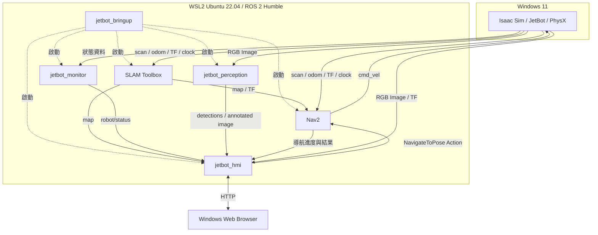

# JetBot ROS2 自主導航與 AI 視覺監控平台

**JetBot ROS2 AI Navigation & Monitoring Platform**

本專案以 NVIDIA Isaac Sim 建立移動機器人模擬環境，整合 ROS2 Humble、SLAM Toolbox、Nav2、YOLO11 與 Flask，開發具備自主導航、AI 物件辨識、即時狀態監控及網頁人機介面（HMI）的機器人控制平台。

專案採用模組化 Python 架構，分別處理機器人模擬、ROS2 通訊、導航、視覺感知與網頁控制，並以 Windows 11 + WSL2 Ubuntu 作為整合開發環境。

目前已完成 ROS 2 Package 化，使用 Ament Python、Colcon 與自製 Launch File 統一管理 WSL2 端的功能模組。完整系統的主要啟動流程由六個終端機簡化為兩個（Windows Isaac Sim 與 WSL2 Bringup）。

> 目前已在既有開發環境完成四個 Package 的基本啟動驗證及 HMI 網頁功能確認；完整依賴宣告與跨電腦重新部署仍待驗證。

## 1. 專案功能

### 1.1 機器人模擬與控制

- 使用 NVIDIA Isaac Sim 建立 JetBot 差速輪移動機器人模擬環境。
- 透過 ROS2 `/cmd_vel` 訂閱控制機器人前進、後退及原地旋轉。
- 整合 RTX LiDAR 與 RGB Camera。
- 發布 `/odom`、`/tf`、`/scan`、`/clock` 等 ROS2 資料。
- 使用 Python Standalone Script 自動建立與執行模擬場景。

### 1.2 SLAM 建圖與自主導航

- 整合 SLAM Toolbox 建立 2D Occupancy Grid Map。
- 使用 TF2 管理 `map`、`odom`、`base_link` 和 `lidar_link` 座標系。
- 整合 Nav2 完成單一目標的路徑規劃及自主導航。
- 支援透過網頁輸入目標座標，或直接點選地圖設定導航位置。
- 透過 ROS2 `NavigateToPose` Action 接收導航進度、完成結果與取消請求。

目前以**單目標自主導航**為主要功能，暫不包含多目標循環巡邏。

### 1.3 Robot State Monitor 系統監控

使用 Python 與 ROS2 開發獨立的機器人狀態監控節點，具備以下功能：

- 機器人位置、朝向與實際速度監控。
- LiDAR 最近有效量測距離。
- ROS2 Topic 更新頻率與通訊狀態檢查。
- TF 時間戳記及座標轉換狀態監控。
- 速度命令與實際速度比較。
- 感測器通訊逾時及異常告警。
- 將整合結果以 JSON 格式發布至 `/robot/status`。

### 1.4 Flask 網頁人機介面（HMI）

以 Flask 開發三分頁式機器人監控與控制平台。

**數據監控**

- 位置、朝向與移動速度。
- 速度變化趨勢圖。
- LiDAR 距離與感測器狀態。
- ROS2 Topic 通訊頻率。
- 系統健康狀態與異常告警。

**SLAM 地圖與導航**

- 即時顯示 `/map` 地圖。
- 顯示機器人在地圖上的位置、朝向與移動軌跡。
- 支援地圖縮放、拖曳與目標選取。
- 支援單目標 Nav2 自主導航。
- 顯示導航任務狀態與結果。

**RGB Camera 與 YOLO**

- 即時顯示 JetBot RGB 相機畫面。
- 支援原始 RGB 與 YOLO 辨識畫面切換。
- 顯示物件類別、信心分數與 Bounding Box。
- 顯示 YOLO 推論時間及影像更新狀態。

### 1.5 YOLO11 AI 物件辨識

- 使用 Ultralytics YOLO11n 預訓練模型。
- 以獨立 Python ROS2 節點訂閱 `/camera/image_raw`。
- 發布 `/yolo/detections` 物件偵測資訊。
- 發布 `/yolo/image_annotated` 標註影像。
- 使用最新影格優先策略，避免持續處理累積的舊影像。
- 已於 Isaac Sim 中使用 YCB 香蕉模型完成實際辨識測試。

目前 YOLO 模組僅負責物件辨識與結果顯示，尚未直接參與導航決策。

### 1.6 ROS 2 Package 化與統一啟動

- 使用 `ament_python` 建立 State Monitor、Flask HMI、YOLO Perception 與 Bringup 四個套件。
- 使用 `colcon build` 管理套件建置，透過 `ros2 run` 執行自製節點。
- 自製 `bringup.launch.py` 整合 SLAM Toolbox、Nav2、State Monitor、YOLO 與 Flask HMI。
- 支援選擇性啟動模組、Nav2 啟動延遲及 YOLO 推論參數設定。
- 透過指定 Python Interpreter 保留 YOLO 獨立虛擬環境，避免與其他節點的 Python 依賴混用。
- Windows 端 Isaac Sim 維持 Standalone Script 執行方式。

## 2. 開發環境與技術

| 分類 | 使用技術 |
|---|---|
| 作業系統 | Windows 11、WSL2 Ubuntu 22.04 |
| 機器人模擬 | NVIDIA Isaac Sim 6.0.1 |
| 機器人通訊 | ROS2 Humble、DDS |
| 程式語言 | Python |
| 地圖建立 | SLAM Toolbox |
| 自主導航 | Navigation2（Nav2） |
| 座標管理 | TF2 |
| AI 物件辨識 | YOLO11n、Ultralytics、PyTorch |
| 人機介面 | Flask、HTML、CSS、JavaScript |
| 套件建置 | Ament Python、Colcon |
| 啟動管理 | ROS 2 Launch、Launch Arguments、Nav2 Lifecycle |
| AI 執行環境 | Python venv（YOLO 獨立環境） |
| 開發工具 | VSCode、Git、GitHub |

## 3. 系統架構

整體系統分為 Windows 模擬層、ROS 2 通訊層、WSL2 功能模組及網頁人機介面。`jetbot_bringup` 負責啟動與設定管理，不介入原本的感測器資料處理或導航決策。



Flask HMI 透過 ROS 2 `NavigateToPose` Action 發送單一導航目標，由 Nav2 負責路徑規劃與控制，再透過 `/cmd_vel` 驅動 Isaac Sim 中的 JetBot。YOLO 辨識結果目前僅用於視覺監控，尚未參與導航決策。

### 3.1 ROS 2 Package 分工

| Package | 功能 | 執行入口 |
|---|---|---|
| `jetbot_monitor` | 機器人狀態監控與異常告警 | `state_monitor` |
| `jetbot_hmi` | Flask 網頁監控與導航控制 | `flask_hmi` |
| `jetbot_perception` | YOLO11 物件辨識 | `yolo_node` |
| `jetbot_bringup` | SLAM、Nav2 與自製節點統一啟動 | `bringup.launch.py` |

### 3.2 主要 ROS 2 通訊介面

| Topic / Action | 主要來源 | 用途 |
|---|---|---|
| `/scan` | Isaac Sim | LiDAR 掃描資料 |
| `/odom` | Isaac Sim | 車身位置、姿態與速度 |
| `/tf`、`/tf_static` | Isaac Sim、SLAM 等節點 | 座標轉換 |
| `/clock` | Isaac Sim | 模擬時間 |
| `/camera/image_raw` | Isaac Sim | RGB 影像 |
| `/camera/camera_info` | Isaac Sim | 相機參數（主程式已實作） |
| `/cmd_vel` | Nav2 / 外部控制 | 底盤速度命令 |
| `/map` | SLAM Toolbox | 2D Occupancy Grid Map |
| `/robot/status` | State Monitor | JSON 系統狀態 |
| `/yolo/detections` | YOLO Node | JSON 物件辨識結果 |
| `/yolo/image_annotated` | YOLO Node | 標註影像 |
| `/navigate_to_pose` (Action) | Nav2 Action Server | 單目標導航 |

目前 Odometry 使用 Isaac Sim 世界姿態及 PhysX 速度資訊，並非由實體輪速 Encoder 積分取得。

## 4. 專案結構

```text
jetbot-ros2-ai-navigation/
├── isaac_sim/
│   └── my_application_V4_camera_writers_cmd_vel_odometry_banana.py
├── ros2_nodes/                        # 保留原始獨立腳本
│   ├── jetbot_state_monitor_v2.py
│   └── jetbot_yolo_ros2_node.py
├── hmi/                               # 保留原始 HMI
│   └── jetbot_flask_hmi_v5_yolo.py
├── config/                            # 原始導航設定
│   ├── slam/mapper_params_online_async.yaml
│   └── nav2/nav2_params.yaml
├── ros2_ws/
│   └── src/
│       ├── jetbot_monitor/
│       │   ├── jetbot_monitor/state_monitor.py
│       │   ├── package.xml
│       │   ├── setup.py
│       │   └── setup.cfg
│       ├── jetbot_hmi/
│       │   ├── jetbot_hmi/flask_hmi.py
│       │   ├── package.xml
│       │   ├── setup.py
│       │   └── setup.cfg
│       ├── jetbot_perception/
│       │   ├── jetbot_perception/yolo_node.py
│       │   ├── package.xml
│       │   ├── setup.py
│       │   └── setup.cfg
│       └── jetbot_bringup/
│           ├── launch/bringup.launch.py
│           ├── config/
│           │   ├── slam/mapper_params_online_async.yaml
│           │   └── nav2/nav2_params.yaml
│           ├── package.xml
│           └── setup.py
├── screenshot/
├── .gitignore
└── README.md
```

上圖省略各 Package 的預設 `resource/`、`test/`、`__init__.py` 等檔案。Colcon 產生的 `ros2_ws/build/`、`install/`、`log/` 不需納入版本控制。原始獨立腳本暫時保留，套件化版本以 `ros2_ws/src/` 為主要開發與啟動入口；使用 Bringup 時應修改其 Package 內的 YAML 設定。

## 5. 系統建置與啟動方式

### 5.1 環境準備

- Windows 11：NVIDIA Isaac Sim 6.0.1 與可正常存取的 Isaac Sim 資產。
- WSL2 Ubuntu 22.04：ROS 2 Humble、SLAM Toolbox、Nav2、Colcon、Flask 及相關 Python 依賴。
- YOLO：相容的 Python 虛擬環境、PyTorch、Ultralytics、影像處理依賴與 YOLO11n 權重。
- Windows 與 WSL2 的 ROS Domain ID 及 DDS 通訊設定須相容。

以下為既有 ROS 2 環境的建置與啟動方式，並非完整的全新電腦安裝腳本。若尚未安裝導航與建置工具，可先安裝下列基礎套件：

```bash
sudo apt update
sudo apt install python3-colcon-common-extensions ros-humble-slam-toolbox ros-humble-navigation2 ros-humble-nav2-bringup
```

若尚未下載專案：

```bash
git clone https://github.com/Jason0126/jetbot-ros2-ai-navigation.git ~/jetbot-ros2-ai-navigation
```

### 5.2 建置 ROS 2 Workspace（WSL2）

在一般 WSL2 終端機中執行，不需要啟用 YOLO 虛擬環境：

```bash
source /opt/ros/humble/setup.bash
export ROS_DOMAIN_ID=0
export RMW_IMPLEMENTATION=rmw_fastrtps_cpp
cd ~/jetbot-ros2-ai-navigation/ros2_ws
colcon build --symlink-install
source install/local_setup.bash
```

若本機另外有必要的 Isaac Sim ROS 2 Workspace，應先載入該 Workspace。新終端機需載入自製 Workspace 才能使用 `ros2 run` 或 `ros2 launch` 尋找本專案套件；也可以在 `~/.bashrc` 中設定自動載入：

```bash
# 放在 ROS 2 Humble 與其他必要 underlay 載入設定之後
if [ -f "$HOME/jetbot-ros2-ai-navigation/ros2_ws/install/local_setup.bash" ]; then
    source "$HOME/jetbot-ros2-ai-navigation/ros2_ws/install/local_setup.bash"
fi
```

檢查套件及 Launch Arguments：

```bash
ros2 pkg list | grep jetbot_
ros2 launch jetbot_bringup bringup.launch.py --show-args
```

### 5.3 確認 YOLO 虛擬環境

目前 Bringup 預設使用 `$HOME/jetbot_yolo_venv/bin/python` 執行 YOLO。啟動前可確認該環境能存取 ROS 2 與 AI 函式庫：

```bash
"$HOME/jetbot_yolo_venv/bin/python" -c "import rclpy, torch, ultralytics; print('All imports OK')"
```

YOLO 權重預設為 `yolo11n.pt`。若不在啟動時的工作目錄，建議透過 `yolo_weights` 指定實際絕對路徑。模型權重及虛擬環境不包含在本 Repository 中。

### 5.4 終端機 1：啟動 Isaac Sim（Windows）

在 Windows CMD 執行：

```cmd
C:\isaacsim\python.bat C:\IsaacProjects\my_application_V4_camera_writers_cmd_vel_odometry_banana.py
```

主程式需依實際檔案位置調整路徑，並確保所參考的 Isaac Sim 資產可正常存取。


### 5.5 終端機 2：啟動完整 ROS 2 系統（WSL2）

先停止原本手動執行的 SLAM、Nav2、State Monitor、YOLO 與 Flask HMI，避免重複節點或 Port 5000 衝突。

```bash
source /opt/ros/humble/setup.bash
source ~/jetbot-ros2-ai-navigation/ros2_ws/install/setup.bash
export ROS_DOMAIN_ID=0
export RMW_IMPLEMENTATION=rmw_fastrtps_cpp
ros2 launch jetbot_bringup bringup.launch.py
```

此指令預設啟動 SLAM Toolbox、Nav2、State Monitor、YOLO 與 Flask HMI。Nav2 預設延遲 5 秒啟動，YOLO 則透過 `ExecuteProcess` 指定獨立 Python Interpreter，無須手動啟用 venv。

### 5.6 Launch Arguments

| 參數 | 預設值 | 用途 |
|---|---|---|
| `use_sim_time` | `true` | SLAM 與 Nav2 使用模擬時間 |
| `enable_slam` | `true` | 啟動 SLAM Toolbox |
| `enable_nav2` | `true` | 啟動 Nav2 |
| `enable_monitor` | `true` | 啟動 State Monitor |
| `enable_hmi` | `true` | 啟動 Flask HMI |
| `enable_yolo` | `true` | 啟動 YOLO |
| `nav2_delay` | `5.0` | Nav2 啟動延遲（秒） |
| `yolo_python` | `~/jetbot_yolo_venv/bin/python` | YOLO Python Interpreter |
| `yolo_weights` | `yolo11n.pt` | 模型權重路徑 |
| `yolo_device` | `cpu` | 推論裝置 |
| `yolo_imgsz` | `320` | 模型輸入尺寸 |
| `yolo_conf` | `0.35` | 信心分數門檻 |
| `yolo_max_fps` | `3` | 最大辨識頻率 |

例如，不啟動 YOLO：

```bash
ros2 launch jetbot_bringup bringup.launch.py enable_yolo:=false
```

僅啟動 Monitor 與 HMI：

```bash
ros2 launch jetbot_bringup bringup.launch.py \
  enable_slam:=false enable_nav2:=false enable_yolo:=false
```

若關閉 SLAM 但仍啟動 Nav2，需另外提供地圖、定位及 `map → odom` TF。固定啟動延遲不保證 SLAM 與 TF 已準備完成。

### 5.7 個別節點啟動（除錯用）

在已載入 Workspace 的終端機中，可分別測試自製節點：

```bash
ros2 run jetbot_monitor state_monitor
```

```bash
ros2 run jetbot_hmi flask_hmi
```

```bash
ros2 run --prefix "$HOME/jetbot_yolo_venv/bin/python" \
  jetbot_perception yolo_node \
  --weights yolo11n.pt --device cpu --imgsz 320 --conf 0.35 --max-fps 3
```

個別啟動方式主要供除錯使用，不需要與完整 Bringup 重複執行。

### 5.8 開啟 Flask HMI

在 Windows 瀏覽器開啟：[http://127.0.0.1:5000](http://127.0.0.1:5000)


<p align="center">
  
  
</p>

<p align="center">
  
  
</p>

### 5.9 系統驗證

另開 WSL2 終端機檢查：

```bash
ros2 node list
ros2 topic list
ros2 action list
ros2 lifecycle get /controller_server
ros2 lifecycle get /planner_server
ros2 lifecycle get /bt_navigator
```

Nav2 三個主要節點正常啟用時應顯示 `active [3]`。進一步檢查實際感測器與辨識資料：

```bash
ros2 topic echo /robot/status --once
ros2 topic echo /yolo/detections --once
ros2 topic hz /scan
```

Topic 或 Action 出現在清單中僅表示通訊介面可被探索，不代表資料持續更新或導航一定成功。完整操作仍須透過 HMI 及 Isaac Sim 進行確認。

## 6. 實驗成果

### 6.1 Nav2 單目標導航

已透過 RViz2 與自行開發的 Flask HMI，成功發送導航目標，並由 Nav2 完成自主導航。

測試結果曾出現：

```text
[controller_server]: Reached the goal!
[bt_navigator]: Goal succeeded
```

### 6.2 YOLO11 物件辨識

於 Isaac Sim 中載入 YCB 香蕉模型，透過 JetBot RGB Camera 擷取影像，使用 YOLO11n 完成辨識。

| 測試項目 | 結果 |
|---|---|
| 辨識類別 | banana |
| 信心分數 | 約 79.6% |
| 影像解析度 | 320 × 240 |
| 推論裝置 | CPU |
| 單張模型推論時間 | 約 30.3 ms |
| HMI 畫面更新率 | 約 1.7 FPS |

上述為特定測試時取得的結果，不代表所有場景下的固定效能。

### 6.3 狀態監控與異常偵測

State Monitor 已通過正常通訊與通訊來源中斷測試。

關閉 Isaac Sim 後，監控程式可偵測 `/odom`、`/scan`、`/clock`、`/tf` 等資料停止更新，並顯示系統異常狀態。

### 6.4 ROS 2 Package 與 Bringup 整合測試

| 測試項目 | 結果 |
|---|---|
| State Monitor / Flask HMI / YOLO Package | 已成功啟動 |
| Bringup Launch File | 已成功啟動 SLAM、Nav2 與三個自製功能模組 |
| Nav2 Lifecycle | `controller_server`、`planner_server`、`bt_navigator` 均顯示 `active [3]` |
| 導航 Action | 已確認 `/navigate_to_pose` 可被探索 |
| YOLO Package 資料輸出 | 已取得 `/yolo/detections` JSON，標註影像測試更新率約 1.5–2.1 Hz |
| HMI 網頁 | 套件化後已確認網頁功能正常 |
| 主要啟動終端機數量 | 6 個 → 2 個 |

上述為既有開發環境的啟動及功能確認結果，尚未完成全新環境部署、長時間穩定性及量化導航成功率測試。

## 7. 已知問題與後續改善

目前已完成主要功能整合，但仍有部分問題待改善：

- **TF 時間戳記異常：** SLAM Toolbox 與 Nav2 長時間執行時，曾出現過期 TF 和雷達訊息被丟棄的情況。
- **相機更新頻率不穩定：** RGB Camera 影像存在短時間停頓，影響 HMI 與 YOLO 顯示流暢度。
- **地圖選點精度：** 地圖點選轉換為 X、Y 座標後，部分四捨五入至小數點後兩位的目標會出現無法成功導航的情況，原因仍待確認。
- **CUDA 相容性：** 目前 YOLO 使用 CPU 推論，後續計畫改善 WSL2 與 RTX GPU 的相容性。

- **套件依賴與部署：** 各自製 Package 的完整 `package.xml` 依賴宣告、Python 依賴版本及全新環境建置流程仍需完善。
- **HMI 關閉流程：** 曾於關閉程式時出現 `ExternalShutdownException`，後續將檢查 ROS 2 Executor 與背景執行緒的資源釋放順序。
- **啟動就緒檢查：** Nav2 目前採固定延遲啟動，後續可研究以 Lifecycle 與 TF 就緒狀態管理啟動順序。

未來可進一步研究 RGB-D 三維物件定位、感知與導航整合，以及更完整的系統測試與效能優化。

## 8. 專案定位

本專案主要展示以下軟體開發能力：

- Python 機器人應用程式開發
- ROS2 通訊與模組整合
- Ament Python 套件化、Colcon 建置與 ROS 2 Launch 統一啟動
- Python 虛擬環境整合與 ROS 2 Workspace 管理
- SLAM 與自主導航系統整合
- Web HMI 人機介面開發
- AI 視覺模型部署與整合
- 系統監控、效能分析與故障排查

專案目前以模擬環境驗證為主，尚未部署至實體 JetBot。

## 9. 第三方軟體與資產

本專案使用 NVIDIA Isaac Sim、ROS2、SLAM Toolbox、Nav2、Ultralytics YOLO11 及 YCB 模型等第三方工具與資產。

相關工具、模型及資產之授權依其原始發布者規定。本 Repository 不包含完整 Isaac Sim 安裝檔案、第三方模型權重或 NVIDIA 資產庫內容。
